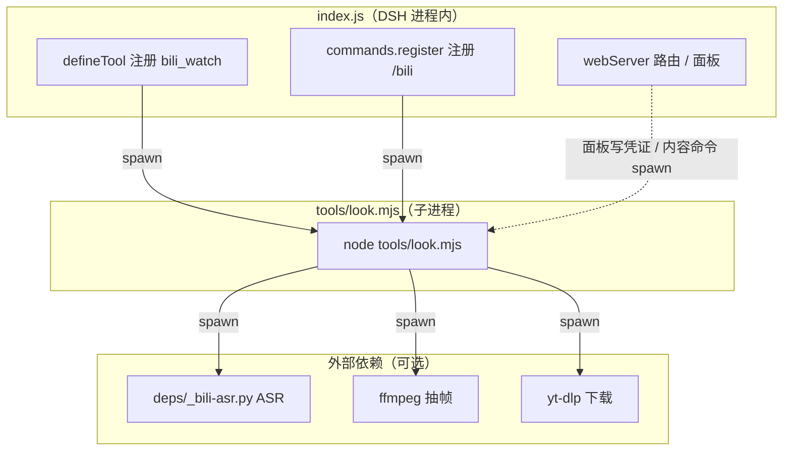

# dsh-bili-watch

[](https://www.npmjs.com/package/dsh-bili-watch)
[](https://www.npmjs.com/package/dsh-bili-watch)
[]()

DSH 插件 / CLI 工具：把 B 站视频解析成模型可消费的结构化内容（元数据、评论、弹幕、AI 字幕、本地 ASR 转写、抽帧 OCR）。

## 为什么用它

- **本地跑不上传**：ASR 转写 + OCR 抽帧全在本机，不依赖云 API、不花钱
- **防字幕诱饵**：语速异常或字幕自称「实验/钓鱼」即判可疑；关键词命中率只在语速也异常时才作补充；可疑时加 `--verify` 抽 5 帧 OCR 比对画面（不加只提示一句）
- **二次读瞬时**：缓存目录 + 文件锁，同一视频二次读取秒出
- **为 AI 设计**：manifest 落盘 + 摘要输出，agent 直接消费不用再解析

## 特性

- 支持 `b23.tv` 短链、BV 号、av 号及通用 URL（经 yt-dlp）
- 降级链：AI 字幕 → 本地 ASR → 抽帧 OCR → 读图，四级全 miss 时退出码为 1
- 匿名可用：元数据、评论、弹幕、搜索、热榜无需登录
- 可选依赖：ffmpeg（抽帧）、Python venv（ASR/OCR）、faster-whisper（转写模型）
- Web 面板：依赖管理、扫码登录、缓存清理、18 项运行时参数可调

## 安装

### DSH 插件

```bash
dsh plugin --profile web add dsh-bili-watch
```

重启 DSH 后生效。DSH ≥ 0.2.0-rc.2 自动写入 `dsh.profile.bundles`；更早版本需手动在 profile `package.json` 的 `dsh.profile.bundles` 数组追加 `"dsh-bili-watch"`。

> **装完重启即可用。** 本插件的 bundle patch 不带 `disabled`，装进 profile 的 `dsh.profile.bundles` 后重启 DSH 就生效，命令直接存在。
>
> 0.3.1 及更早的版本不是这样：包在装的那一刻就被写进 `dsh.profile.bundles`（`reconcile()` 干的），所以插件页显示「已启用」，但实际不加载——因为层里那行 `disabled: true` 是插件页开关碰不到的位置。症状是「显示已启用但命令不存在，点开关也没用」。那个 `disabled` 是 0.2.17 应急修 bug 时误加的，带了 7 个版本，0.3.2 已去掉。

> **从旧版本升级的注意**：`reconcile()` 只在「新增依赖」时跑，所以以前手动从 `dsh.profile.bundles` 删过包名的人，`pnpm update` 到 0.3.2 之后包名不会自动补回来，需要重跑一次 `dsh plugin --profile web add dsh-bili-watch`。

验证：`dsh --profile web --dump-config` 输出中可检索到 `dsh-bili-watch`。

亦可直接放入 `profiles/<name>/node_modules/dsh-bili-watch`。

插件依赖 `@deepseek-ai/dsh-tools`（peer, optional）。缺失时 `bili_watch` 工具不注册，`/bili` 命令与面板仍可用。

### CLI 全局安装

```bash
npm i -g dsh-bili-watch
bili-watch view BV1EPnG6DEJC
```

或 clone 后直接运行：

```bash
node tools/look.mjs view BV1EPnG6DEJC
```

## 用法

### 命令一览

| 命令 | 说明 |
|---|---|
| `view <target>` | 元数据 + 简介 + 热评。不下载、不依赖 ffmpeg，匿名可用 |
| `peek <target>` | 元数据 + 热评 + 5 帧画面。先取 B 站官方截帧接口，不下视频；取不到才回落下载 360p 抽帧（约 1 MB/min）；OCR 环境就绪时顺带识别。仅 B 站 |
| `sub <BV或链接> [--format srt\|json\|md\|txt] [--out <path>]` | AI 字幕。`--format` 输出 SRT / JSON（含时间戳）/ Markdown（含跳转链接）/ 纯文本 txt。需登录 |
| `comments <bv> [N]` | 评论区，默认按热度排序 |
| `asr <target>` | 本地 ASR 转写，附「可信 / 疑似幻觉」判定 |
| `frames <target> [--step <sec>] [--ocr]` | 抽帧；`--ocr` 附带画面文字识别 |
| `ocr <bv>` | 抽帧并 OCR |
| `text <target> [--format json\|md]` | 四级降级链：字幕 → 转写 → 抽帧 OCR → 读图。全 miss 退出码 1 |
| `sheet <bv> [--grid 3x3]` | 均匀抽帧拼图，默认 9 帧 |
| `substrip <bv> [--step <sec>]` | 底部字幕竖拼 |
| `danmaku <bv>` | 弹幕热区（按时间桶统计峰值） |
| `local <path> [--ocr] [--frames]` | 本地视频文件走降级链（从转写层起）。仅 CLI |
| `search <关键词> [--days 3] [--limit 10] [--order pubdate\|click]` | 视频搜索。`--days` 生效时最多抓 3 页，结果仍按 `--limit` 截断 |
| `hot [--limit 10]` | 综合热门榜 |
| `login [--check] [--poll] [--key <key>]` | 扫码登录。`--check` 校验凭证有效性；`--key` 需配合 `--poll` |
| `clean` | 清空缓存根。任务进行中（锁文件存活）时拒绝并返回非零退出码 |

`<target>` 接受 BV 号、`b23.tv` 短链、av 号或 URL。

### 通用参数

| 参数 | 类型 | 默认值 | 说明 |
|---|---|---|---|
| `--format` | enum | — | 输出格式。`text` / `sub` / `comments` / `danmaku` / `local` 落盘时必须配合此参数，单独指定 `--out` 返回退出码 1 |
| `--out <path>` | string | — | 落盘路径，相对当前工作目录（cwd），目录不存在时自动创建。`text` / `sub` / `comments` / `danmaku` / `local` 写文件；`frames` 用它指定输出目录。`sheet` / `ocr` / `substrip` 固定写缓存目录，不收 `--out` |
| `--ffmpeg <path>` | string | — | ffmpeg 可执行文件路径 |
| `--cred <path>` | string | — | 凭证 JSON 路径，格式 `{sessdata, bili_jct, buvid3, buvid4}` |
| `--asr-max <ms>` | number | 1800000 | 转写时长闸门（毫秒）。视频长于此值时仅输出画面描述 |
| `--head <n>` | number | 0（按自动规则） | 只给前 n 字。不传或传 0 时按「正文超过 800 字只给开头 400 字 + 落盘路径」处理；要全文用 `--full` |
| `--full` | flag | — | 输出全文（不截断） |
| `--verify` | flag | — | 字幕可疑时抽 5 帧 OCR 交叉校验。字幕正常时不触发 |
| `--fresh` | flag | — | 忽略缓存强制重跑 |
| `--mark-seen` | flag | — | 标记为已读 |
| `--no-time` | flag | — | text/sub 默认输出带 `[mm:ss]` 逐句时间码，加这个退回纯文本（不带时间戳） |
| `--at <时刻>` | string | — | `frames` 精看某一刻，支持三种写法：`750`（秒）、`12:30`（分:秒）、`12:30-13:10`（区间） |

完整参数列表见 `bili-watch help`。

### 长文本保护

正文超过 800 字时，终端仅返回前 400 字摘要 + 落盘路径，全文写入缓存目录。工具层（`bili_watch`）阈值为 2000 字（摘要 800 字）。

## 面板

装进 DSH 后，在插件页点 `dsh-bili-watch` 卡片进详情页，里面有一块面板（不用先进设置），日常操作不用去对话里敲命令：

- **依赖状态**：ffmpeg、yt-dlp、ASR 环境、OCR 环境、转写模型、B 站登录凭证逐项列出是否就绪、实际路径、占用体积。缺的点行末按钮装（走内置 `fetch-deps`，体积是估算值，实际以跑完为准）。**下载期间要保持 DSH 开着**——宿主退出会连下载进程一起结束，重进面板再点一次即可，已经下完的项会自动跳过。
- **扫码登录**：未登录显示「去扫码登录」，已登录是「重新扫码」。二维码在面板里出，手机 B 站扫完自动刷新。凭证存在本机 `$DSH_HOME/bili-watch/credential.json`。
- **哪些能删**：yt-dlp、转写模型、登录凭证可以直接删；ffmpeg / ASR 环境 / OCR 环境不给删除按钮——环境删了要重跑 `fetch-deps` 装回来，代价比省下的空间大，面板只在旁边标出实际位置。
- **批量操作**：标题行的「批量下载 / 批量清理」打开勾选清单，删除前会再确认一次。
- **抽帧缓存**：显示当前占用与文件数，「立即清除」一键清空；不点则按规则自动清理（保留天数、总量上限），超过从最旧的删起。规则存 `deps/cache-config.json`，启动时与打开面板时各查一次。
- **缓存位置**：默认 `$DSH_HOME/bili-watch/cache`（`$DSH_HOME` 是 DSH 家目录，Windows 下通常是用户目录里的 `.dsh`）。登录凭证是它的兄弟文件，清缓存时别把上一层一起删。换位置用环境变量 `BILI_WATCH_CACHE`，或 `deps/deps-config.json` 里的 `"cache"`；指到还不是缓存根的目录时，插件会在里面建 `bili-watch-cache/`，不会直接拿你的目录当缓存根。`clean` 与面板发现旧位置还有东西、又没本工具的标记时会提示一句——本版不动那些文件，要清理得你自己删。
- **运行时参数**：转写闸门、抽帧张数上限这类常改的放常规组，其余收在「高级设置」里（默认收起），每项都标了范围和「调大/调小会怎样」。
- **最近一次调用**：显示命令、时间、成败，用来判断上一次是不是卡住了。

0.3.2 起装完重启就是启用状态，不用再去插件页手动打开。

## 配置

### 环境变量

| 变量 | 默认值 | 说明 |
|---|---|---|
| `BILI_WATCH_PROJ` | `deps/` | ASR/OCR 环境目录 |
| `BILI_WATCH_FFMPEG` | — | ffmpeg 可执行文件路径 |
| `BILI_WATCH_YTDLP` | — | yt-dlp 可执行文件路径 |
| `BILI_WATCH_SEEN` | `deps/seen.md` | 已读标记文件路径 |
| `BILI_WATCH_CACHE` | `$DSH_HOME/bili-watch/cache` | 抽帧缓存根目录。优先级：环境变量 > `deps/deps-config.json` > 默认值 |
| `BILI_WATCH_MIRROR` | — | 设为 `cn` 时 `fetch-deps` 走国内镜像 |
| `HF_ENDPOINT` | `https://hf-mirror.com` | 转写模型下载端点 |
| `BILI_ASR_MODEL` | `small` | faster-whisper 模型名 |

### 运行时参数（面板可调）

以下参数通过 Web 面板或 `deps/deps-config.json` 调整，保存后立即生效：

| 参数 | 类型 | 默认值 | 说明 |
|---|---|---|---|
| `asrMemMB` | number (MB) | 1536 | 本地 ASR 内存门槛。低于此值跳过转写 |
| `lockTtlMin` | number (min) | 30 | 残留锁过期时长 |
| `unitLimit` | number (chars) | 5000 | 单条评论/弹幕截断阈值 |
| `textLimit` | number (chars) | 800 | 文本层单次返回正文上限 |
| `toolTextCap` | number (chars) | 2000 | 工具层单次返回正文总上限 |
| `toolHead` | number (chars) | 800 | 工具层默认返回头部字数 |
| `dmBucketSec` | number (sec) | 30 | 弹幕分桶宽度 |
| `dmTop` | number (buckets) | 5 | 弹幕热区输出条数 |
| `downloadMaxMB` | number (MB) | 512 | 单文件下载体积上限 |
| `subRateMin10` | number (×10 chars/s) | 20 | 字幕语速下限（2.0 字/秒） |
| `subRateMax10` | number (×10 chars/s) | 85 | 字幕语速上限（8.5 字/秒） |
| `textBrief` | number (chars) | 400 | 超长文本摘要长度 |
| `asrMaxSec` | number (sec) | 1800 | 转写时长闸门 |
| `maxFrames` | number | 500 | 抽帧张数上限 |
| `asrTimeoutSec` | number (sec) | 900 | ASR 进程超时 |
| `ffmpegTimeoutSec` | number (sec) | 300 | ffmpeg 进程超时 |
| `cmdTimeoutSec` | number (sec) | 180 | 通用命令超时 |
| `asrDevice` | enum | `auto` | ASR 推理设备：`auto`（有 CUDA 就用，失败回落 CPU）/ `cpu`（强制 CPU）。面板上是「转写时用 GPU」开关 |

## 缓存路径

默认缓存根：`$DSH_HOME/bili-watch/cache`（`$DSH_HOME` 默认为用户目录下 `.dsh`）。

- 登录凭证：`$DSH_HOME/bili-watch/credential.json`（缓存根的兄弟文件，清理缓存时勿误删上级目录）
- 自定义缓存位置：设置 `BILI_WATCH_CACHE` 环境变量，或在 `deps/deps-config.json` 写入 `"cache": "<dir>"`。指向外部目录时插件自动创建 `bili-watch-cache/` 子目录作为缓存根
- 修改后需重启 DSH 生效
- 自动清理规则（保留天数 / 总量上限）存于 `deps/cache-config.json`，默认保留 7 天 / 上限 2048 MB，启动时与打开面板时各检查一次
- **缓存根归插件专用**：`clean` 与面板「立即清除」按名字整棵删这 10 个子目录 —— `_logs` `frames` `sheets` `sheet-tmp` `substrip-tmp` `_misc` `asr` `frames-dl` `audio-dl` `_hot`，里面的东西一律不保留。别把自己的文件放进这些名字的目录；放在缓存根**根目录下**、名字不在上表的文件不会被删（`clean` 会跳过并列进「不是 bili-watch 的缓存条目」）

## 卸载

```bash
dsh plugin --profile web remove dsh-bili-watch
```

### 卸载前备份

0.3.4 起依赖与配置都在 `$DSH_HOME/bili-watch/deps`（包外），卸载**不会**删掉。只有首次启动还没把包内 `deps/` 搬完的用户（这时仍在用包内那份）才需要提前拷出以下 4 份文件，重装后放回原位：

1. `deps/deps-config.json` — 运行时参数与自定义缓存路径
2. `deps/cache-config.json` — 自动清理规则
3. `deps/ui-config.json` — 面板显示开关
4. `deps/seen.md` — 已读标记（或将 `BILI_WATCH_SEEN` 指向包外路径）

### 卸载后残留

- 登录凭证 `$DSH_HOME/bili-watch/credential.json` 不在包内，卸载不删除；如需清除手动删除
- 缓存根 `$DSH_HOME/bili-watch/cache` 不在包内，卸载不删除；仅清理 `cache/` 子目录，勿删上级凭证文件

## 依赖

| 能力 | 依赖 | 缺失行为 |
|---|---|---|
| 元数据 / 评论 / 弹幕 / 搜索 / 热榜 | 无（匿名 HTTP） | — |
| 抽帧 / 九宫格 / 字幕带 | ffmpeg | 报错并提示安装方式 |
| AI 字幕 | B 站登录态（SESSDATA） | 返回无字幕轨，降级至下一级 |
| 本地 ASR | Python 3.10–3.14 + faster-whisper（`deps/.venv-asr`）+ VC++ 运行库 | 跳过，降级 |
| 画面 OCR | Python 3.10–3.14 + rapidocr_onnxruntime（`deps/.venv-ocr`）+ VC++ 运行库 | 跳过，仅基础抽帧 |
| 通用 URL | yt-dlp | 仅支持 B 站 |

环境要求：Node.js ≥ 22。

> **VC++ 运行库**：ASR 与 OCR 用的 `faster-whisper` / `onnxruntime` 是 C++ 编译的 wheel，运行时要 `vcruntime140.dll`。Windows 10/11 一般自带，但精简过的企业镜像可能没有——症状是 pip 装得上、`import` 时报 `DLL load failed while importing …`。这时装一遍 [Microsoft Visual C++ 2015–2022 Redistributable (x64)](https://aka.ms/vs/17/release/vc_redist.x64.exe)，与 Python 版本无关，不必重装 venv。

`ffmpeg` 查找顺序：`--ffmpeg` > `BILI_WATCH_FFMPEG` > `deps/deps-config.json` > `deps/ffmpeg.exe` > `PATH`。

### 一键安装依赖

```powershell
# Windows
powershell -ExecutionPolicy Bypass -File scripts\fetch-deps.ps1 -Target all
powershell -ExecutionPolicy Bypass -File scripts\fetch-deps.ps1 -Target all -Mirror cn

# 单项：ffmpeg / ytdlp / asr / ocr / model
powershell -ExecutionPolicy Bypass -File scripts\fetch-deps.ps1 -Target ytdlp
```

```bash
# macOS / Linux
bash scripts/fetch-deps.sh all
BILI_WATCH_MIRROR=cn bash scripts/fetch-deps.sh all
```

> **依赖装在哪**（0.3.4 起）：默认放 `$DSH_HOME/bili-watch/deps`（`DSH_HOME` 默认 `~/.dsh`），**不在插件包目录里**——这样 `npm uninstall` / 重装插件不会把两个 venv 和 460 MB 模型一起删掉。
> 从旧版升级时，首次启动会自动把包内 `deps/` 搬过去（复制完成后才切换，中途失败继续用包内那份，面板会给出提示）；包内旧的 `deps/` 不再使用，确认新位置正常后可以手动删除。
> 想放到别的盘：设环境变量 `BILI_WATCH_DEPS` 指向目标目录即可（CLI、面板、一键脚本三处同源）。

## GPU 加速（可选）

只有**本地 ASR 转写**用得上 GPU，OCR 走 onnxruntime 的 CPU 推理，与显卡无关。

| 你的机器 | 面板「GPU 运行库」一行 | 转写 |
|---|---|---|
| 有 NVIDIA 卡 + 已装运行库 | 绿点，显示 `cublas64_12.dll` | 走 GPU，比 CPU 快 2–8 倍 |
| 有 NVIDIA 卡 + 没装运行库 | 灰点，提示「装上快 2-8 倍」 | 走 CPU（功能一样，只是慢些） |
| 没有 NVIDIA 卡 | 灰点，说明没有 `nvidia-smi` | 走 CPU |

**怎么装**：面板上点那一行的「下载」，或命令行：

```powershell
powershell -ExecutionPolicy Bypass -File scripts\fetch-deps.ps1 -Target cuda
```

装的是 pip 上的三个 wheel（`nvidia-cublas-cu12` + `nvidia-cudnn-cu12` + `nvidia-cuda-nvrtc-cu12`），**约 500 MB**，装在 ASR 的 venv 里，不需要装整套 CUDA Toolkit。装完脚本会真加载一次 `cublas64_12.dll` 校验——pip 装成功不代表 DLL 能加载（缺 VC++ Redist 时会 `DLL load failed`）。

**为什么第一次慢**：`-Target all` 不会自动装它（不问、不装 500 MB）；首次转写还要加载模型到显存，比后续调用慢十几秒。

**怎么关**：面板「转写与抽帧」里的「转写时用 GPU」取消勾选（存的是 `asrDevice: cpu`），或把 `deps/deps-config.json` 里的 `asrDevice` 写成 `cpu`。删掉运行库也能自动退回 CPU，不会报错。

**没有卡能不能开**：能，但开了也走 CPU——`auto` 的语义是「有可用 CUDA 就用，没有或显存不足就回落 CPU」。

## 故障排查

### 凭证

仅 AI 字幕需要登录。凭证优先级：`--cred` > `$DSH_HOME/bili-watch/credential.json` > 匿名。

watch 只读自己这一份，不会去跟随同机其它工具写的凭证（旧版会按 mtime 挑最新的那份，容易出现「面板显示已退出、实际还在用别的身份」）。早期版本留下的旧位置凭证（`deps/` 下那份）会在第一次读到时**一次性**复制到 `$DSH_HOME/bili-watch/credential.json`，之后不再回读。

凭证文件等同账号登录态，禁止外传或提交版本库。

### 转写可信度

本地 ASR 输出附判定字段：

- **可信**：VAD 检测到足够人声，无跨窗重复模板句
- **疑似幻觉**：VAD 人声 < 0.5 秒却输出文本、跨 2 秒以上窗口重复文本占比 > 50%、`no_speech_prob > 0.5` 分段占比过半

判为疑似幻觉时应通过抽帧 OCR 交叉验证，不可直接引用为台词。

### 降级链行为

```
AI 字幕（需登录）
   ↓ 无字幕轨
本地 ASR（可选）
   ↓ 未安装 / 语速 < 2 字/秒
抽帧 + OCR（可选）
   ↓ 未安装
读图（模型直接看帧）
```

降级时输出原因，不静默跳过。四级全 miss 退出码 1。

### 字幕诱饵检测

`text` 命令自动检测以下可疑信号：

- 字幕语速不在 2–8.5 字/秒区间
- 字幕与标题 / UP 主关键词重合度过低（需与语速异常同时触发）
- 字幕包含「实验 / 钓鱼 / 测试」字样

指定 `--verify` 时额外抽 5 帧 OCR 比对画面文字。仅在可疑信号触发时生效，正常字幕不触发。

### 限制

- B 站侧只读：不支持点赞、评论、发弹幕、历史记录
- 通用 URL 走 yt-dlp 时不做内网地址过滤，禁止指向内网服务
- 无内置限速，批量调用需自行 sleep
- 工具名 `bili_watch` 与命令 `/bili` 若与其他插件冲突，后注册者覆盖前者

## 成本

- 字幕接口带一次重试；`text` 最多尝试两次（先匿名，有凭证再试一次）。
- 抽帧要下载视频（360p）再跑 ffmpeg，`--step` 调大能少抽；脚本另外限了 `-threads 2`，不会把机器吃满。
- 拼图（`sheet`）和字幕带（`substrip`）把多帧压成一张图给模型看，省 token。
- 本地转写、OCR 都在本机跑，不上传、不按次计费；只有取 B 站数据的接口走网络。

## 模块架构



## 致谢

- [`dsh-bilibili-video-summary`](https://github.com/Aurum807)（Aurum807）：单链接自动提示形态
- [`dsh-bilibili-subtitles`](https://github.com/Chenfan2)（Chenfan2）：多格式导出形态
- [`video-watch-plus`](https://github.com/xinhailaopo/video-watch-plus)（MIT）：ASR 幻觉证伪方法

## License

MIT
