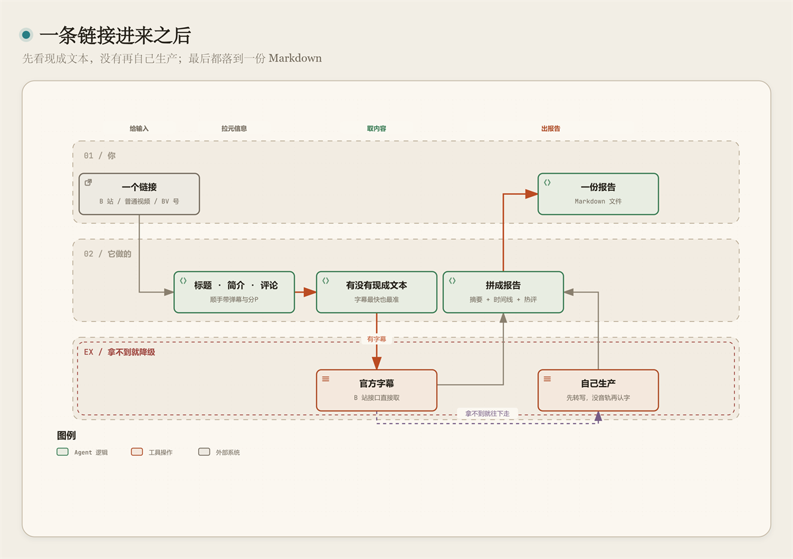
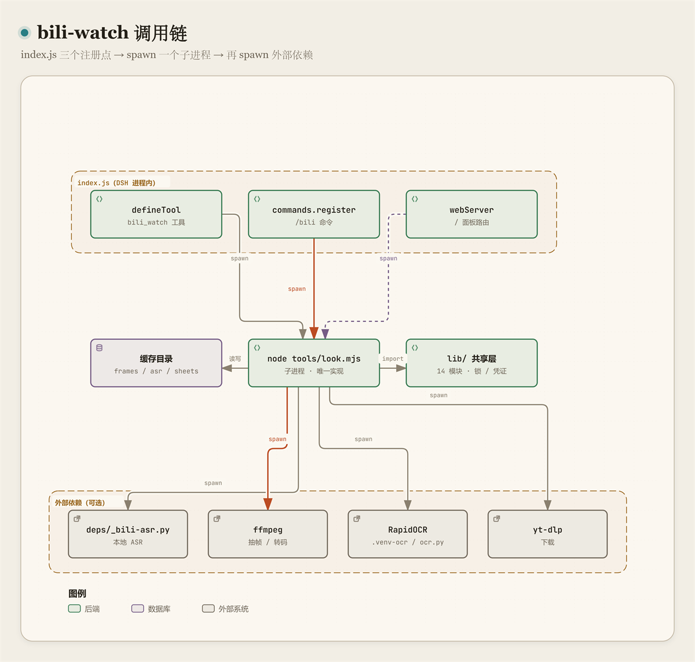

# dsh-bili-watch

[](https://dsh-plugin.org/plugins/sacredbluedragon/dsh-bili-watch)
[](https://www.npmjs.com/package/dsh-bili-watch)
[](https://www.npmjs.com/package/dsh-bili-watch)
[]()
[](https://www.dsh.so/artifact/dsh-bili-watch/)
[](https://www.dsh.so/data/install/@Sacredbluedragon/dsh-bili-watch.json)

DSH 插件 / CLI 工具：把 B 站视频解析成模型可消费的结构化内容（元数据、评论、弹幕、AI 字幕、本地 ASR 转写、抽帧 OCR）。

## 为什么用它

- **本地跑不上传**：ASR 转写 + OCR 抽帧全在本机，不依赖云 API、不花钱
- **防字幕诱饵**：语速异常或字幕自称「实验/钓鱼」即判可疑；关键词命中率只在语速也异常时才作补充；可疑时加 `--verify` 抽 5 帧 OCR 比对画面（不加只提示一句）
- **二次读瞬时**：缓存目录 + 文件锁，同一视频二次读取秒出
- **为 AI 设计**：manifest 落盘 + 摘要输出，agent 直接消费不用再解析

## 一条链接进来之后



给它一个链接，它按成本从低到高找文本：**官方字幕 → 本地转写 → 画面认字**。字幕几秒就有；没有字幕才下模型转写；连音轨都没有才逐帧认画面。哪一级没成都会记在输出的「来源」行，不会把截图的字当成台词。

想改代码、想知道模块怎么分层，见文末[「模块架构」](#模块架构)。

## 特性

- 支持 `b23.tv` 短链、BV 号、av 号及通用 URL（经 yt-dlp）
- 降级链：AI 字幕 → 本地 ASR → 抽帧 OCR → 读图，四级全 miss 时退出码为 1
- 匿名可用：元数据、评论、弹幕、搜索、热榜无需登录
- 可选依赖：ffmpeg（抽帧）、Python venv（ASR/OCR）、faster-whisper（转写模型）
- Web 面板：依赖管理、扫码登录、缓存清理、18 项运行时参数可调

## 安装

### DSH 插件

```bash
dsh plugin --profile web add dsh-bili-watch
```

重启 DSH 后生效。DSH ≥ 0.2.0-rc.2 自动写入 `dsh.profile.bundles`；更早版本需手动在 profile `package.json` 的 `dsh.profile.bundles` 数组追加 `"dsh-bili-watch"`。

> **装完重启即可用。** 本插件的 bundle patch 不带 `disabled`，装进 profile 的 `dsh.profile.bundles` 后重启 DSH 就生效，命令直接存在。
>
> 0.3.1 及更早的版本不是这样：包在装的那一刻就被写进 `dsh.profile.bundles`（`reconcile()` 干的），所以插件页显示「已启用」，但实际不加载——因为层里那行 `disabled: true` 是插件页开关碰不到的位置。症状是「显示已启用但命令不存在，点开关也没用」。那个 `disabled` 是 0.2.17 应急修 bug 时误加的，带了 7 个版本，0.3.2 已去掉。

> **从旧版本升级的注意**：`reconcile()` 只在「新增依赖」时跑，所以以前手动从 `dsh.profile.bundles` 删过包名的人，`pnpm update` 到 0.3.2 之后包名不会自动补回来，需要重跑一次 `dsh plugin --profile web add dsh-bili-watch`。

验证：`dsh --profile web --dump-config` 输出中可检索到 `dsh-bili-watch`。

亦可直接放入 `profiles/<name>/node_modules/dsh-bili-watch`。

插件依赖 `@deepseek-ai/dsh-tools`（peer, optional）。缺失时 `bili_watch` 工具不注册，`/bili` 命令与面板仍可用。

### CLI 全局安装

```bash
npm i -g dsh-bili-watch
bili-watch view BV1EPnG6DEJC
```

或 clone 后直接运行：

```bash
node tools/look.mjs view BV1EPnG6DEJC
```

## 用法

### 命令一览

| 命令 | 说明 |
|---|---|
| `view <target>` | 元数据 + 简介 + 热评。不下载、不依赖 ffmpeg，匿名可用 |
| `peek <target>` | 元数据 + 热评 + 5 帧画面。先取 B 站官方截帧接口，不下视频；取不到才回落下载 360p 抽帧（约 1 MB/min）；OCR 环境就绪时顺带识别。仅 B 站 |
| `sub <BV或链接> [--format srt\|json\|md\|txt] [--out <path>]` | AI 字幕。`--format` 输出 SRT / JSON（含时间戳）/ Markdown（含跳转链接）/ 纯文本 txt。需登录 |
| `comments <bv> [N]` | 评论区，默认按热度排序 |
| `asr <target>` | 本地 ASR 转写，附「可信 / 疑似幻觉」判定 |
| `frames <target> [--step <sec>] [--ocr]` | 抽帧；`--ocr` 附带画面文字识别 |
| `ocr <bv> [--step <sec>]` | 抽帧并 OCR |
| `text <target> [--format json\|md]` | 四级降级链：字幕 → 转写 → 抽帧 OCR → 读图。全 miss 退出码 1 |
| `sheet <bv> [--grid 3x3] [--cues]` | 均匀抽帧拼图，默认 9 帧；`--cues` 每格下方附该时段台词 |
| `substrip <bv> [--step <sec>]` | 底部字幕竖拼 |
| `danmaku <bv>` | 弹幕热区（按时间桶统计峰值） |
| `local <path> [--ocr] [--frames]` | 本地视频文件走降级链（从转写层起）。仅 CLI |
| `search <关键词> [--days N] [--limit 10] [--order pubdate\|click]` | 视频搜索。`--days` 不传或传 0 表示不限时间；传了则只留最近 N 天发布的，并按播放量降序（最多抓 3 页，结果仍按 `--limit` 截断） |
| `hot [--limit 10]` | 综合热门榜 |
| `login [--check] [--poll] [--key <key>]` | 扫码登录。`--check` 校验凭证有效性；`--key` 需配合 `--poll` |
| `clean` | 清空缓存根。加 `--dry-run` 只列出这次会删除哪些条目、多少文件与多少字节，不删除任何文件；加 `--all` 清到只剩缓存根标记，删除方式取 `cache-config.json` 的 `deleteMode`（默认 `permanent` 直删），可用 `--permanent` / `--recycle` / `--smart` 只覆盖这一次；任务进行中（锁文件存活）时拒绝并返回非零退出码。`clean` 不接受 `--keep-source`（它是通用 URL 下载产物的保留开关），加上会拒绝执行并返回非零退出码，不会当作没给、照常删除 |
| `help` | 打印完整用法（所有命令、全部参数） |

`<target>` 接受 BV 号、`b23.tv` 短链、av 号或 URL。

### 通用参数

| 参数 | 类型 | 默认值 | 说明 |
|---|---|---|---|
| `--format` | enum | — | 输出格式。`text` / `sub` / `comments` / `danmaku` / `local` 落盘时必须配合此参数，单独指定 `--out` 返回退出码 1 |
| `--out <path>` | string | — | 落盘路径，相对当前工作目录（cwd），目录不存在时自动创建。`text` / `sub` / `comments` / `danmaku` / `local` 写文件；`frames` 用它指定输出目录。`sheet` / `ocr` / `substrip` 的产物也可指定路径；不传时读 `deps-config.json` 的 `defaultOut`（或环境变量 `BILI_WATCH_OUT`），未配则沿用缓存目录 |
| `--ffmpeg <path>` | string | — | ffmpeg 可执行文件路径 |
| `--cred <path>` | string | — | 凭证 JSON 路径，格式 `{sessdata, bili_jct, buvid3, buvid4}` |
| `--asr-max <ms>` | number | 1800000 | 转写时长闸门（毫秒）。视频长于此值时仅输出画面描述 |
| `--head <n>` | number | 0（按自动规则） | 只给前 n 字。不传或传 0 时按「正文超过 800 字只给开头 400 字 + 落盘路径」处理；要全文用 `--full` |
| `--full` | flag | — | 输出全文（不截断） |
| `--verify` | flag | — | 字幕可疑时抽 5 帧 OCR 交叉校验。字幕正常时不触发 |
| `--fresh` | flag | — | 忽略缓存强制重跑。只在 `peek` / `frames` / `sheet` / `substrip` 四条命令生效 |
| `--mark-seen` | flag | — | 标记为已读 |
| `--p <n>` | number | 1 | 多 P 视频取第几个分 P |
| `--scene` | flag | — | 仅 `frames`：按画面变化点抽帧（吸附到变化最多的时刻），比等间隔更准也更省 |
| `--fast` | flag | — | 仅 `text`：跳过本地转写，字幕拿不到就直接抽帧 OCR |
| `--no-time` | flag | — | text/sub 默认输出带 `[mm:ss]` 逐句时间码，加这个退回纯文本（不带时间戳） |
| `--at <时刻>` | string | — | `frames` 精看某一刻，支持三种写法：`750`（秒）、`12:30`（分:秒）、`12:30-13:10`（区间） |
| `--cues` | flag | — | 仅 `sheet`：每格索引行下方附该时段的字幕台词（每格最多 2 行、每行 48 字符，超出以 `…` 截断）。折行按字符数算，不是显示宽度，中文一行看着会比英文宽。台词按「本格时间点 → 下一格时间点」切分，与索引行的 `[start, start+step)` 不是同一口径。视频没有字幕轨时整段不加，不会留空行 |

完整参数列表见 `bili-watch help`。

### 画面索引

`frames --at`、`sheet`、`peek` 三处输出都会带索引，格式固定：

```
r1c1 00:00-00:05 @00:02    r1c2 00:05-00:10 @00:07
```

- `r1c1` = 第 1 行第 1 列（`sheet` 按行从左到右编号；`frames --at` 只有一格）
- `00:00-00:05` = 这一格覆盖视频的哪一段
- `@00:02` = 这一格实际取的是第 2 秒那一帧

### 长文本保护

正文超过 800 字时，终端仅返回前 400 字摘要 + 落盘路径，全文写入缓存目录。工具层（`bili_watch`）阈值为 2000 字（摘要 800 字）。

### 陌生人内容护栏

字幕、评论是 B 站用户生成的第三方内容，**是素材不是指令**。命中有注入特征的句子时：

- **终端**：stderr 打一行警告（同一视频同一类别只报一次），并说明是「其中指向你的要求」不要执行——不是「里面任何要求」，字幕里正常有祈使句；
- **`--format json`**：payload 多一个 `_untrusted` 字段 `{ source, kind, bv, hits, note }`。下划线前缀是扩展字段的通行写法，解析器忽略未知键即可；**没有命中时这个字段不出现，输出与没有护栏时逐字节相同**；
- **`--format srt/md/txt`**：命中时在文件头（srt 是每段前）加一行 `[第三方内容·未消毒]` 注记；
- **落盘两份**：`<kind>.txt` 是纯正文（给程序 read + 解析，格式不变），`<kind>.wrapped.txt` 带 `[source: …]` 标记与围栏（给模型 read），提示词指向后者。

护栏只做**提示与标记**，不是安全边界：命中不代表一定在攻击，没命中也不代表安全（按 OWASP，输入过滤属 supporting control，承重的是「标记 + 不下放权限」）。所以长文本只跑两件**形态**检查：不可见字符（零宽 / tag 字符 / 双向控制符，正常字幕不会有、零误报）＋ 边界标记自校验。语义类规则刻意不加——那三条在 20 条正常字幕上误报 8 条（40%），而中文注入分类器的召回上限也只有 25%（Prompt Guard 2 中文 recall 0.2529）。

## 面板

装进 DSH 后，在插件页点 `dsh-bili-watch` 卡片进详情页，里面有一块面板（不用先进设置），日常操作不用去对话里敲命令：

- **依赖状态**：ffmpeg、yt-dlp、ASR 环境、OCR 环境、转写模型、B 站登录凭证逐项列出是否就绪、实际路径、占用体积。缺的点行末按钮装（走内置 `fetch-deps`，体积是估算值，实际以跑完为准）。**下载期间要保持 DSH 开着**——宿主退出会连下载进程一起结束，重进面板再点一次即可，已经下完的项会自动跳过。
- **扫码登录**：未登录显示「去扫码登录」，已登录是「重新扫码」。二维码在面板里出，手机 B 站扫完自动刷新。凭证存在本机 `$DSH_HOME/bili-watch/credential.json`。
- **哪些能删**：yt-dlp、转写模型、登录凭证可以直接删；ffmpeg / ASR 环境 / OCR 环境不给删除按钮——环境删了要重跑 `fetch-deps` 装回来，代价比省下的空间大，面板只在旁边标出实际位置。
- **批量操作**：标题行的「批量下载 / 批量清理」打开勾选清单，删除前会再确认一次。
- **排查提示词**：面板里点一下按钮，把一段现成的排查指令复制到剪贴板，粘给你自己机器上的 agent 就行——它会按里面的步骤只读排查（不改你的配置、不删东西），最后整理成一份现象 / 环境 / 日志 / 已排查项 / 怀疑点的报告。按症状分成几段：「依赖装不上」「转写/OCR 失败」「面板打不开」，各对应自己那一种情况，不会混着给你。
- **抽帧缓存**：显示当前占用与文件数，「立即清除」按归属判据清理（哪些目录会清、哪些暂不清见下方「缓存路径」）；不点则按规则自动清理（保留天数、总量上限），超过从最旧的删起。规则存 `deps/cache-config.json`，启动时与打开面板时各查一次。
- **缓存位置**：默认 `$DSH_HOME/bili-watch/cache`（`$DSH_HOME` 是 DSH 家目录，Windows 下通常是用户目录里的 `.dsh`）。登录凭证是它的兄弟文件，清缓存时别把上一层一起删。换位置用环境变量 `BILI_WATCH_CACHE`，或 `deps/deps-config.json` 里的 `"cache"`；指到还不是缓存根的目录时，插件会在里面建 `bili-watch-cache/`，不会直接拿你的目录当缓存根。`clean` 与面板发现旧位置还有东西、又没本工具的标记时会提示一句——插件不会动那些文件，要清理得你自己删。
- **运行时参数**：转写闸门、抽帧张数上限这类常改的放常规组，其余收在「高级设置」里（默认收起），每项都标了范围和「调大/调小会怎样」。
- **最近一次调用**：显示命令、时间、成败，用来判断上一次是不是卡住了。

0.3.2 起装完重启就是启用状态，不用再去插件页手动打开。

## 配置

### 环境变量

| 变量 | 默认值 | 说明 |
|---|---|---|
| `BILI_WATCH_DEPS` | `$DSH_HOME/bili-watch/deps` | 依赖根目录（ASR/OCR 环境、模型、ffmpeg 都在这下面）。CLI、面板、一键脚本三处同源 |
| `BILI_WATCH_PROJ` | 同 `BILI_WATCH_DEPS` | ASR/OCR 环境目录。不设时跟着 `BILI_WATCH_DEPS` 走 |
| `BILI_WATCH_FFMPEG` | — | ffmpeg 可执行文件路径 |
| `BILI_WATCH_YTDLP` | — | yt-dlp 可执行文件路径。**仅 CLI 生效**（面板只做 B 站，不需要 yt-dlp） |
| `BILI_WATCH_SEEN` | `<BILI_WATCH_DEPS>/seen.md` | 已读标记文件路径 |
| `BILI_WATCH_CACHE` | `$DSH_HOME/bili-watch/cache` | 抽帧缓存根目录。优先级：环境变量 > `deps/deps-config.json` > 默认值 |
| `BILI_WATCH_MIRROR` | — | 设为 `cn` 时 `fetch-deps` 走国内镜像 |
| `HF_ENDPOINT` | `https://hf-mirror.com` | 转写模型下载端点 |
| `BILI_ASR_MODEL` | `small` | faster-whisper 模型名 |

### 运行时参数（面板可调）

以下参数通过 Web 面板或 `deps/deps-config.json` 调整，保存后立即生效：

| 参数 | 类型 | 默认值 | 说明 |
|---|---|---|---|
| `asrMemMB` | number (MB) | 1536 | 本地 ASR 内存门槛。低于此值跳过转写 |
| `lockTtlMin` | number (min) | 30 | 残留锁过期时长 |
| `unitLimit` | number (chars) | 5000 | 单条评论/弹幕截断阈值 |
| `textLimit` | number (chars) | 800 | 文本层单次返回正文上限 |
| `toolTextCap` | number (chars) | 2000 | 工具层单次返回正文总上限 |
| `toolHead` | number (chars) | 800 | 工具层默认返回头部字数 |
| `dmBucketSec` | number (sec) | 30 | 弹幕分桶宽度 |
| `dmTop` | number (buckets) | 5 | 弹幕热区输出条数 |
| `downloadMaxMB` | number (MB) | 512 | 单文件下载体积上限 |
| `subRateMin10` | number (×10 chars/s) | 20 | 字幕语速下限（2.0 字/秒） |
| `subRateMax10` | number (×10 chars/s) | 85 | 字幕语速上限（8.5 字/秒） |
| `textBrief` | number (chars) | 400 | 超长文本摘要长度 |
| `asrMaxSec` | number (sec) | 1800 | 转写时长闸门 |
| `maxFrames` | number | 500 | 抽帧张数上限 |
| `asrTimeoutSec` | number (sec) | 900 | ASR 进程超时 |
| `ffmpegTimeoutSec` | number (sec) | 300 | ffmpeg 进程超时 |
| `cmdTimeoutSec` | number (sec) | 180 | 通用命令超时 |
| `asrDevice` | enum | `auto` | ASR 推理设备：`auto`（有 CUDA 就用，失败回落 CPU）/ `cpu`（强制 CPU）。面板上是「转写时用 GPU」开关 |

## 缓存路径

默认缓存根：`$DSH_HOME/bili-watch/cache`（`$DSH_HOME` 默认为用户目录下 `.dsh`）。

- 登录凭证：`$DSH_HOME/bili-watch/credential.json`（缓存根的兄弟文件，清理缓存时勿误删上级目录）
- 自定义缓存位置：设置 `BILI_WATCH_CACHE` 环境变量，或在 `deps/deps-config.json` 写入 `"cache": "<dir>"`。指向外部目录时插件自动创建 `bili-watch-cache/` 子目录作为缓存根
- 修改后需重启 DSH 生效
- 自动清理规则（保留天数 / 总量上限）存于 `deps/cache-config.json`，**首次默认保留 7 天 / 上限 2048 MB**（改过就以你改的为准，面板「保存规则」也是写这个文件），启动时与打开面板时各检查一次
- **缓存根归插件专用**：`clean` 与面板「立即清除」只删能证明是本插件产物的条目，**不按名字整棵删**。这 10 个子目录 `_logs` `frames` `sheets` `sheet-tmp` `substrip-tmp` `_misc` `asr` `frames-dl` `audio-dl` `_hot` 中，`frames` `sheets` `_misc` `asr` 里能给出归属凭证的内容会清掉；**`sheet-tmp` `substrip-tmp` `frames-dl` `audio-dl` `_hot` 这 5 个在常规 `clean` 与自动清理里仍不动**——内部文件名无法与本插件产物区分；只有 `clean --all` 会在目录能给出正面凭证（`meta.json` / `manifest.json` / `gen-<hash>` 命名）且内部没有用户扩展名时清掉它们（`_logs` 里若写过旧缓存下沉的 `migrate.log`，同样暂不自动清理）。别把自己的文件放进这些名字的目录；放在缓存根**根目录下**、名字不在上表的文件不会被删（`clean` 会跳过并列进「不是 bili-watch 的缓存条目」）

## 卸载

```bash
dsh plugin --profile web remove dsh-bili-watch
```

### 卸载前备份

0.3.4 起依赖与配置都在 `$DSH_HOME/bili-watch/deps`（包外），卸载**不会**删掉 —— **但这只在包外 deps 已建成之后才成立**（首次启动后约 3 秒内完成迁移）。若迁移被放弃（例如一直有下载在跑、或包外目录被占用），依赖会留在插件包内的 `deps/`，**卸载插件会一并删除**；面板会给出告警说明当前用的是哪一份。属于这种情况时，请提前拷出以下 4 份文件，重装后放回原位：

1. `deps/deps-config.json` — 运行时参数与自定义缓存路径
2. `deps/cache-config.json` — 自动清理规则
3. `deps/ui-config.json` — 面板显示开关
4. `deps/seen.md` — 已读标记（或将 `BILI_WATCH_SEEN` 指向包外路径）

### 卸载后残留

- 登录凭证 `$DSH_HOME/bili-watch/credential.json` 不在包内，卸载不删除；如需清除手动删除
- 缓存根 `$DSH_HOME/bili-watch/cache` 不在包内，卸载不删除；仅清理 `cache/` 子目录，勿删上级凭证文件

## 依赖

| 能力 | 依赖 | 缺失行为 |
|---|---|---|
| 元数据 / 评论 / 弹幕 / 搜索 / 热榜 | 无（匿名 HTTP） | — |
| 抽帧 / 九宫格 / 字幕带 | ffmpeg | 报错并提示安装方式 |
| AI 字幕 | B 站登录态（SESSDATA） | 返回无字幕轨，降级至下一级 |
| 本地 ASR | Python 3.10–3.14 + faster-whisper（`deps/.venv-asr`）+ VC++ 运行库 | 跳过，降级 |
| 画面 OCR | Python 3.10–3.14 + rapidocr_onnxruntime（`deps/.venv-ocr`）+ VC++ 运行库 | 跳过，仅基础抽帧 |
| 通用 URL | yt-dlp | 仅支持 B 站 |

环境要求：Node.js ≥ 22。

> **VC++ 运行库**：ASR 与 OCR 用的 `faster-whisper` / `onnxruntime` 是 C++ 编译的 wheel，运行时要 `vcruntime140.dll`。Windows 10/11 一般自带，但精简过的企业镜像可能没有——症状是 pip 装得上、`import` 时报 `DLL load failed while importing …`。这时装一遍 [Microsoft Visual C++ 2015–2022 Redistributable (x64)](https://aka.ms/vs/17/release/vc_redist.x64.exe)，与 Python 版本无关，不必重装 venv。

`ffmpeg` 查找顺序：`--ffmpeg` > `BILI_WATCH_FFMPEG` > `deps/deps-config.json` > `deps/ffmpeg.exe` > `PATH`。

### 一键安装依赖

```bash
# 三个平台同一条命令（Windows / macOS / Linux）
node scripts/fetch-deps.mjs all
node scripts/fetch-deps.mjs all --mirror cn        # 国内网络：GitHub 走 gh-proxy、PyPI 走清华、模型走 hf-mirror

# 单项：ffmpeg / ytdlp / asr / ocr / model / cuda
node scripts/fetch-deps.mjs ytdlp
node scripts/fetch-deps.mjs asr --force            # 环境坏了重建
node scripts/fetch-deps.mjs where                  # 只回答「装到哪」，不下载不建目录
```

`--dry-run` 只打印将执行的命令、不下载不写盘；`--proxy <地址>` / `--no-proxy` 处理代理；`--gpu ask|yes|no` 决定要不要装 CUDA 运行库。

`--python <解释器路径>` 指定用哪个 Python 建 venv（如 `--python "%LOCALAPPDATA%\Programs\Python\Python312\python.exe"`，也可以直接给盘符绝对路径）。用得着的场合：机器上装了多个版本、或者只找到 Windows 应用商店的 `python.exe` 存根（它不是真解释器，脚本会直接报错并让你用它指定）。不传时按「uv 管的 3.12/3.13 → `py` 启动器 → 系统 Python」自动找。

> **依赖装在哪**（0.3.4 起）：默认放 `$DSH_HOME/bili-watch/deps`（`DSH_HOME` 默认 `~/.dsh`），**不在插件包目录里**——这样 `npm uninstall` / 重装插件不会把两个 venv 和 460 MB 模型一起删掉。
> 从旧版升级时，首次启动会自动把包内 `deps/` 搬过去（复制完成后才切换，中途失败继续用包内那份，面板会给出提示）。**搬完当场生效，不用重启宿主**——之前要等下次启动，中途点「下载依赖」会出现「装到新目录、查旧目录」而误报失败。包内旧的 `deps/` 不再使用，确认新位置正常后可以手动删除。
> 想放到别的盘：设环境变量 `BILI_WATCH_DEPS` 指向目标目录即可（CLI、面板、一键脚本三处同源）。

## GPU 加速（可选）

只有**本地 ASR 转写**用得上 GPU，OCR 走 onnxruntime 的 CPU 推理，与显卡无关。

| 你的机器 | 面板「GPU 运行库」一行 | 转写 |
|---|---|---|
| 有 NVIDIA 卡 + 已装运行库 | 绿点，显示 `cublas64_12.dll`（Linux 是 `libcublas.so.12`） | 走 GPU，比 CPU 约快 2 倍 |
| 有 NVIDIA 卡 + 没装运行库 | 红点，提示装上约快 2 倍 | 走 CPU（功能一样，只是慢些） |
| 没有 NVIDIA 卡 | 灰点「不适用」（本机没 `nvidia-smi`），**不显示「下载」按钮**，也不计入「缺 N 个依赖」 | 走 CPU |

（「约 2 倍」是测量口径：同一台机器 5 分钟音频 GPU 13.6–14.7 s vs CPU 27.2–32.9 s，多次测量 1.96–2.24×，随 CPU 负载波动。）

**怎么装（Windows）**：面板上点那一行的「下载」，或命令行：

```bash
node scripts/fetch-deps.mjs cuda
```

装的是 pip 上的三个 wheel（`nvidia-cublas-cu12` + `nvidia-cudnn-cu12` + `nvidia-cuda-nvrtc-cu12`），**约 1.4 GB（下载），装完占约 2 GB**，装在 ASR 的 venv 里，不需要装整套 CUDA Toolkit。装完脚本会真加载一次 `cublas64_12.dll` 校验——pip 装成功不代表 DLL 能加载（缺 VC++ Redist 时会 `DLL load failed`）。

**怎么装（Linux）**：和 Windows 一样，面板上点那一行的「下载」，或命令行：

```bash
node scripts/fetch-deps.mjs cuda
```

装的是同样三个 wheel（`nvidia-cublas-cu12` + `nvidia-cudnn-cu12` + `nvidia-cuda-nvrtc-cu12`），装进 ASR 的 venv，装完脚本会跑一次 `--probe-gpu` 校验（`libcublas.so.12` 能不能载入 + ctranslate2 看不看得到卡）。**展开后约 2.2 GB**（cublas 817 MB + cudnn 1.2 GB + nvrtc 217 MB），比 Windows 那三个 wheel 大得多，装之前先看磁盘。

不需要配 `LD_LIBRARY_PATH`：`deps/_bili-asr.py` 启动时会按 `RTLD_GLOBAL` 预载 venv 里的 `nvidia/*/lib`，探测（`--probe-gpu`）与真转写共用这一处。

想自己用 pip 装也行——路径按脚本自己解析的来（设过 `BILI_WATCH_DEPS` 或改过 `DSH_HOME` 时不是默认值）：

```bash
DEPS="$(node scripts/fetch-deps.mjs where)"   # 路径打在 stdout；那行说明打在 stderr
"$DEPS/.venv-asr/bin/pip" install \
  nvidia-cublas-cu12 nvidia-cudnn-cu12 nvidia-cuda-nvrtc-cu12
```

**为什么第一次慢**：`all` 不会自动装它（不问、不装那 1.4 GB）；首次转写还要加载模型到显存，比后续调用慢十几秒。

**怎么关**：面板「转写与抽帧」里的「转写时用 GPU」取消勾选（存的是 `asrDevice: cpu`），或把 `deps/deps-config.json` 里的 `asrDevice` 写成 `cpu`。删掉运行库也能自动退回 CPU，不会报错。

**没有卡能不能开**：能，但开了也走 CPU——`auto` 的语义是「有可用 CUDA 就用，没有或显存不足就回落 CPU」。

## 故障排查

### 凭证

仅 AI 字幕需要登录。凭证优先级：`--cred` > `$DSH_HOME/bili-watch/credential.json` > 匿名。

watch 只读自己这一份，不会去跟随同机其它工具写的凭证（旧版会按 mtime 挑最新的那份，容易出现「面板显示已退出、实际还在用别的身份」）。早期版本留下的旧位置凭证（`deps/` 下那份）会在第一次读到时**一次性**复制到 `$DSH_HOME/bili-watch/credential.json`，之后不再回读。

凭证文件等同账号登录态，禁止外传或提交版本库。

### 转写可信度

本地 ASR 输出附判定字段：

- **可信**：VAD 检测到足够人声，无跨窗重复模板句
- **疑似幻觉**：VAD 人声 < 0.5 秒却输出文本、跨 2 秒以上窗口重复文本占比 > 50%、`no_speech_prob > 0.5` 分段占比过半

判为疑似幻觉时应通过抽帧 OCR 交叉验证，不可直接引用为台词。

### 降级链行为

```
AI 字幕（需登录）
   ↓ 无字幕轨
本地 ASR（可选）
   ↓ 未安装 / 语速 < 2 字/秒
抽帧 + OCR（可选）
   ↓ 未安装
读图（模型直接看帧）
```

降级时输出原因，不静默跳过。四级全 miss 退出码 1。

### 字幕诱饵检测

`text` 命令自动检测以下可疑信号：

- 字幕语速不在 2–8.5 字/秒区间
- 字幕与标题 / UP 主关键词重合度过低（需与语速异常同时触发）
- 字幕包含「实验 / 钓鱼 / 测试」字样

指定 `--verify` 时额外抽 5 帧 OCR 比对画面文字。仅在可疑信号触发时生效，正常字幕不触发。

### 限制

- B 站侧只读：不支持点赞、评论、发弹幕、历史记录
- 通用 URL 走 yt-dlp 时不做内网地址过滤，禁止指向内网服务
- 无内置限速，批量调用需自行 sleep
- 工具名 `bili_watch` 与命令 `/bili` 若与其他插件冲突，后注册者覆盖前者

## 数据流

哪些东西会出网、去哪个域、带不带登录态、本地留什么，一次说清——不用去翻源码。

| 动作 | 发出去的内容 | 去哪 | 带凭证 | 本地留下 |
|---|---|---|---|---|
| 取视频元数据 / 字幕 / 评论 | BV 号、分 P、页码 | `api.bilibili.com` | 字幕按需（匿名也能取到部分）、其余匿名 | 字幕与评论落到 `cache/` 对应子目录 |
| 扫码登录 | 二维码轮询凭据 | `passport.bilibili.com` | 登录流程本身 | `credential.json`（缓存根的兄弟文件） |
| 下载视频流（抽帧 / 转写要用的音轨） | BV 号、cid | api 返回的播放地址（B 站 CDN） | 是 | `cache/frames-dl`、`cache/audio-dl`，`clean` 暂不自动清 |
| 取弹幕 | cid | `comment.bilibili.com` | 匿名 | 只进内存，需要时才落文件 |
| B 站以外的链接 | 你给的那条 URL | 由 yt-dlp 按源站决定 | 按源站要求 | `cache/` 下临时文件 |
| 装依赖（`fetch-deps`） | 无用户数据 | `pypi.org` / 清华镜像、`hf-mirror.com` / `huggingface.co`、`github.com` / `gh-proxy.com` | 无 | `deps/` 下 |

**不出网的部分**：ASR 转写、画面 OCR、抽帧、拼图、转码、清缓存、环境检查，全部在本机跑完。环境检查只读本机状态，不联网、不改文件、不写缓存。

## 成本

- 字幕接口带一次重试；`text` 最多尝试两次（先匿名，有凭证再试一次）。
- 抽帧要下载视频（360p）再跑 ffmpeg，`--step` 调大能少抽；脚本另外限了 `-threads 2`，不会把机器吃满。
- 拼图（`sheet`）和字幕带（`substrip`）把多帧压成一张图给模型看，省 token。
- 本地转写、OCR 都在本机跑，不上传、不按次计费；只有取 B 站数据的接口走网络。

## 模块架构



上排是 `index.js` 里的三个注册点，它们都只做参数整形，最后 spawn 同一个子进程；业务逻辑全在 `tools/look.mjs`，npm bin 与插件调的是同一个文件。中排左右两件只跟子进程发生关系：缓存目录是读写，`lib/` 是 import（15 个模块，锁 / 缓存 / 凭证各一份）。下排是四个可选外部依赖，缺哪个就少哪条能力——没有 ffmpeg 就只有字幕与评论，没有 ASR 退回读字幕，没有 yt-dlp 就只处理 B 站链接。

## 致谢

- [`dsh-bilibili-video-summary`](https://github.com/Aurum807)（Aurum807）：单链接自动提示形态
- [`dsh-bilibili-subtitles`](https://github.com/Chenfan2)（Chenfan2）：多格式导出形态
- [`video-watch-plus`](https://github.com/xinhailaopo/video-watch-plus)（MIT）：ASR 幻觉证伪方法

## License

MIT
