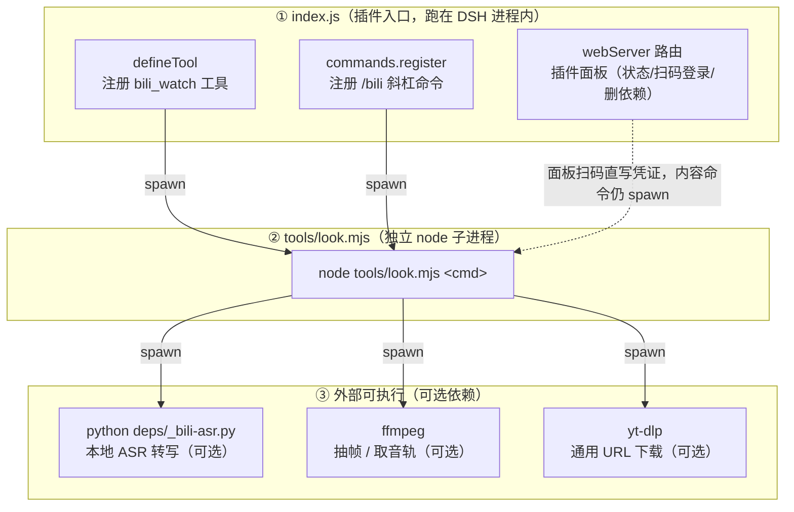

# dsh-bili-watch

将一条 B 站视频变成模型能读的内容：元数据、评论、弹幕、AI 字幕、本地转写、抽帧 OCR。可作为 DSH 插件运行，也可直接当命令行工具。支持 `b23.tv` 短链与 av 号；抽帧缓存位置可自定义，见下面「插件面板」的「缓存位置」。

取内容的顺序是先用文字（字幕或转写），文字不够则抽帧看画面。只读元数据、评论、弹幕、搜索、热榜不需要任何额外依赖；抽帧相关命令需要 ffmpeg，未安装会明确报错并指出装法。

> [!IMPORTANT]
> 面板要重启 DSH 后才出现，插件只在启动时加载。
> 抽帧类命令（`peek` 的 5 帧 / `frames` / `ocr` / `sheet` / `substrip` / `text` 的兜底档）需要 ffmpeg，没有会直接报错，不会静默降级。
> 登录只影响 AI 字幕；其余命令匿名可用。

## 安装

### 装进 DSH 当插件

```bash
dsh plugin --profile web add dsh-bili-watch
```

装完重启 DSH 即可。DSH 0.2.0-rc.2 起，`dsh plugin add` 会把包自动写进 profile 的 `dsh.profile.bundles`；若用更早的内核，需要自己打开 profile 的 `package.json`，在 `dsh.profile.bundles` 数组里补一行 `"dsh-bili-watch"`。

装完可以验证：`dsh --profile web --dump-config` 里能搜到 `dsh-bili-watch` 才算进了装配。

也可以把本仓库直接放进 `profiles/<名字>/node_modules/dsh-bili-watch`。

插件依赖 DSH 自带的 `@deepseek-ai/dsh-tools`（peer，optional）。profile 里缺这个包时不会报错：`bili_watch` 工具不注册，`/bili` 命令与插件面板照常可用，日志里会打一行提示。

0.2.30 起要求 DSH ≥ 0.2.0-rc.2（`engines` 不硬卡，代码层兼容 0.2.0）。

插件市场已收录（2026-10-21）：在市场里搜 `dsh-bili-watch` 安装。新装插件默认不自动启用，装完到「插件」页把它的开关打开，再重启 DSH；市场里暂时搜不到时，按上面的命令装。

### 只当命令行工具

```bash
npm i -g dsh-bili-watch
bili-watch view BV1EPnG6DEJC
```

不装全局也行：clone 仓库后在目录里跑 `node tools/look.mjs view BV1EPnG6DEJC`。命令行的依赖和插件完全一样，`scripts/fetch-deps` 同样可用。

### 更新与卸载

```bash
dsh plugin --profile web add dsh-bili-watch@latest
dsh plugin --profile web remove dsh-bili-watch
```

升级后重启 DSH。`deps/` 在包目录内，卸载或重装会连模型、环境一起删掉（**登录凭证不在 `deps/`**，它已经搬到 `$DSH_HOME/bili-watch/`）；把 `BILI_WATCH_SEEN` 指到包外可以保住「已看过」记录。**注意 `BILI_WATCH_PROJ` 只影响运行时查找顺序，不影响 `fetch-deps` 的安装位置**——`fetch-deps` 永远装进包内 `deps/`，而且查找时 `deps/` 优先，所以「指到包外」这一步要真的生效，得先让包内 `deps/.venv-*` 不存在。**抽帧缓存根在包目录外**（默认 `~/.dsh/bili-watch/cache`，即 `$DSH_HOME/bili-watch/cache`；自定义过 `BILI_WATCH_CACHE` 就指到你自己设的位置，插件会在那个目录下再建一层 `bili-watch-cache/` 当缓存根），`dsh plugin remove` 不会动它，卸载后需手动删这个缓存目录。**只删 `cache/` 这一层：登录凭证是它的兄弟文件 `$DSH_HOME/bili-watch/credential.json`，删了要重新扫码。** 日常清理在面板里逐项删即可。

## 模块架构



所有内容命令（search/hot/peek/view/sub/asr/frames/ocr/...）最终都走 `tools/look.mjs` 这一份实现；`index.js` 只负责把 DSH 的工具/命令/面板入口接到同一个 spawn 上。`deps/_bili-asr.py`、`ffmpeg`、`yt-dlp` 都是可选依赖，没装时对应档位自动降级或报错（见下「依赖」）。

## 插件面板

装进 DSH 后，打开插件列表，点 `dsh-bili-watch` 卡片进详情页，里面有一块面板（不用先进设置），常规操作无需去对话里敲命令：

- **依赖状态**：ffmpeg、yt-dlp、ASR 环境、OCR 环境、转写模型、登录凭证逐项列出是否就绪、实际路径、占用体积。缺的点击行末「一键下载」，后台跑 `scripts/fetch-deps`（体积是估算值，实际以跑完为准）。
- **扫码登录**：凭证未登录时点「去扫码登录」（已登录是「重新扫码」），面板里弹出二维码，手机 B 站扫完自动刷新。凭证保存在本机 `$DSH_HOME/bili-watch/credential.json`。
- **删除**：面板按实际路径判断——yt-dlp、转写模型、登录凭证可直接删；ffmpeg / ASR 环境 / OCR 环境不提供删除按钮（环境删了要重跑 `fetch-deps` 装回来，代价大于省下的空间），旁边标出它实际在哪。
- **批量**：标题行的「批量下载 / 批量清理」打开勾选清单，默认勾上所有可操作的项，删除前会再确认一次。
- **抽帧缓存**：显示当前占用与文件数，「立即清除」一键清空；不点则会按规则自动清理——保留天数（默认 7 天）与总量上限（默认 2048 MB），超过则从最旧的删起。规则存在 `deps/cache-config.json`，插件启动和打开面板时各检查一次。
- **缓存位置**：默认在 DSH 家目录下再往下一层的 `cache/`（`$DSH_HOME/bili-watch/cache`；`$DSH_HOME` 就是 DSH 的家目录，Windows 下通常是用户目录里的 `.dsh`）。登录凭证是它的**兄弟文件** `$DSH_HOME/bili-watch/credential.json`，清缓存时别把上一层一起删。要换位置就设环境变量 `BILI_WATCH_CACHE`，或在 `deps/deps-config.json` 里写 `"cache": "<你的缓存目录>"`（指到一个还不是缓存根的目录时，插件会在里面建 `bili-watch-cache/`，不会直接拿你的目录当缓存根）；改完重启 DSH 生效，面板「抽帧缓存 → 位置」会显示当前实际路径。
- **最近一次调用**：显示命令、时间、成败，用来判断上一次看视频是否卡住。

装完第一次重启 DSH，面板才会出现。

## 依赖

| 能力 | 需要 | 没有时 |
|---|---|---|
| 元数据 / 评论 / 弹幕 / 搜索 / 热榜 | 无（匿名 HTTP） | — |
| 抽帧 / 九宫格 / 字幕带 | `ffmpeg` | 报错并提示装法（`text` 的兜底档就是抽帧，所以同样要 ffmpeg） |
| AI 字幕 | 一次扫码登录（SESSDATA） | 返回「无字幕轨」，自动降级 |
| 本地转写 | Python 3.10+ 与 faster-whisper（`deps/.venv-asr`） | 跳过，自动降级 |
| 画面 OCR | Python 3.10+ 与 rapidocr_onnxruntime（`deps/.venv-ocr`） | 跳过，只剩基础抽帧 |
| 通用视频 URL | yt-dlp | 只支持 B 站 |

环境：Node.js ≥ 22。装在 DSH 里时 DSH 自带 node，命令行跑也一样。

`ffmpeg` 查找顺序：`--ffmpeg` 参数 → `BILI_WATCH_FFMPEG` → `deps/deps-config.json` 里的 `ffmpeg` → 插件 `deps/ffmpeg.exe` → PATH。

`deps/` 用来放运行期文件：Python venv、模型、yt-dlp，默认不进 git（见 `.gitignore`）。登录凭证**不在** `deps/`，见上文的 `$DSH_HOME/bili-watch/credential.json`。ASR 和 OCR 的 Python 环境是可选的，不装也能用，只是少这两档。

`deps/_bili-asr.py` 默认从 `hf-mirror.com` 下模型，国内快。海外网络可以先设 `HF_ENDPOINT=https://huggingface.co` 再跑 `fetch-deps`。

### 可选依赖（一键安装）

```powershell
# Windows（powershell.exe 或 pwsh 都行）
powershell -ExecutionPolicy Bypass -File scripts\fetch-deps.ps1 -Target all
powershell -ExecutionPolicy Bypass -File scripts\fetch-deps.ps1 -Target all -Mirror cn   # 国内网络：gh-proxy + 清华 PyPI + hf-mirror

# 单项：ffmpeg / ytdlp / asr / ocr / model
powershell -ExecutionPolicy Bypass -File scripts\fetch-deps.ps1 -Target ytdlp
powershell -ExecutionPolicy Bypass -File scripts\fetch-deps.ps1 -Target model
```

```bash
# macOS / Linux
bash scripts/fetch-deps.sh all
BILI_WATCH_MIRROR=cn bash scripts/fetch-deps.sh all
```

脚本可以重复跑：目标已存在就跳过；Windows 用 `-Force` 重下、`-DryRun` 只打印命令（sh 版没有这两个参数，要重装就删掉目标目录）。装 venv 时会验证包能不能 import，上次装到一半的会被重建。`-Target model` 需要 ASR 环境先装好，脚本会提示。

**从 GitHub 下载很慢或断**：ffmpeg 要从 GitHub 拉约 80 MB 的压缩包，国内直连经常断。三条替代路径：

1. 加 `-Mirror cn` 重试（走 gh-proxy）；
2. 手动下载 `ffmpeg.exe` 放进 `deps\` 再重跑（会被跳过）；
3. 已经有 ffmpeg 就设 `BILI_WATCH_FFMPEG` 指向它。

macOS/Linux 的 ffmpeg 用系统包管理器装，脚本只给提示。其余目标和 Windows 一样；sh 版本单项失败会跑完再汇总。

## 凭证

匿名也有内容：元数据、评论、抽帧、弹幕都不需要登录。

只有拿 AI 字幕需要登录，二选一：

1. `login`：插件出二维码，手机 B 站扫码。凭证存在 `$DSH_HOME/bili-watch/credential.json`，不出本机。
2. `--cred <文件路径>`：读一份现成的 `{sessdata, bili_jct, buvid3, buvid4}` JSON。

凭证顺序：给了 `--cred` 就只用它，读不到就按匿名跑；没给 `--cred` 才用 `$DSH_HOME/bili-watch/credential.json`；两者都没有就匿名。**例外：** 本机若同时装有 bili-duty，且它的 `$DSH_HOME/bili-duty/bili_credential.json` 比 watch 自己那份更新，watch 会优先用那一份（同一台机器复用登录态）。因此「在面板里删掉凭证」不等于「立刻变匿名」——bili-duty 那份还在时会继续用它。

这份文件等同账号登录态。请勿分享、提交、上传。

## 命令

| 命令 | 做什么 |
|---|---|
| `view <BV或链接或URL>` | 元数据 + 简介 + 热评（不下载、不依赖 ffmpeg，永远能跑） |
| `peek <BV或链接>` | 元数据 + 热评 + 5 张均匀帧（需下载 360p 约每分钟 1 MB + 抽帧约 2 秒；装了 OCR 环境时会顺带识别这 5 帧；仅 B 站） |
| `sub <BV或链接> [--format srt\|json\|md\|txt] [--out 文件（需配合 --format）]` | AI 字幕 + 两判据（字/秒、关键词重合；时长只用作语速的分母）；`--format` 输出 SRT、JSON（带官方时间戳）、Markdown（每条带跳回原片的链接）或纯文本 txt（不带时间戳） |
| `comments <BV> [N]` | 评论区，默认按热度排序 |
| `asr <BV或URL>` | 本地转写音频，并给出「可信 / 疑似幻觉」判定（见下节） |
| `frames <BV或URL> [--step 秒] [--ocr]` | 抽帧；`--ocr` 顺带识别画面文字 |
| `ocr <BV>` | 抽帧并 OCR |
| `text <BV或URL> [--format json\|md]` | 四级链：字幕 → 转写 → 抽帧 OCR；`--format json` 带上时间轴口径（字幕 exact，转写与 OCR 是估算）；`md` 有字幕时出时间轴，没有就出标题+全文；SRT 只有 `sub` 支持 |
| `sheet <BV> [--grid 3x3]` | 均匀挑帧拼成一张图（`NxM` 如 `3x3`、`4x4`，默认 9 帧） |
| `substrip <BV> [--step 秒]` | 底部字幕竖拼成一张图 |
| `danmaku <BV>` | 弹幕热区（按时间桶统计峰值） |
| `local <文件路径> [--ocr] [--frames]` | 本地视频文件走同一条四级链（字幕层不适用，直接从转写起）。**仅 CLI 可用**，`bili_watch` 工具与 `/bili` 不提供 |
| `search <关键词> [--days 3] [--limit 10] [--order pubdate\|click]` | 搜视频。`--days` 生效时最多抓 3 页再筛，结果仍按 `--limit` 截断 |
| `hot [--limit 10]` | 综合热门榜 |
| `login [--check] [--poll] [--key KEY]` | 扫码登录。`--check` = 检查本地凭证是否还有效（不会重新登录）；`--key KEY` 需配合 `--poll` 才生效（单独 `login --key X` 会被静默忽略） |
| `clean` | 清空缓存根（默认 `$DSH_HOME/bili-watch/cache`；只清本插件自己写的 `BV*` 与 `frames/`、`asr/`、`_logs/` 等目录，同一层里别人的文件不动，凭证在上一层不会被碰到）。有任务在跑（存在 `*.lock` 且持有进程还活着）时会拒绝清理并返回非零退出码；进程已被强杀的残留锁不算占用 |

工具侧的等价入口：13 个内容命令在 `bili_watch` 工具、`/bili` 命令、CLI 三处等价（工具参数是 `command` + `bv`，另有 `format` / `out` / `limit` 等字段）；`login` 与 `clean` 只有 `/bili` 和 CLI；`local` 只有 CLI。

表里只列常用参数。完整参数（`--out`（**必须配合 `--format`，只给 `--out` 会报错退出**）、`--fresh`、`--scene`、`--ffmpeg`、`--cred`、`--fast`、`--mark-seen`、`--p`、`--asr-max`（转写时长闸门，默认 30 分钟，单位毫秒）等）跑 `bili-watch help` 看。

## 单条链接软提示

用户的消息里只有一条 B 站视频链接（BV 号或 `b23.tv` 短链）时，插件往消息流里补一句提示，告诉 agent 有这条链接可读、用 `peek` 先看一眼（需下载 360p 约每分钟 1 MB + 抽帧约 2 秒）。它**不会**替用户调用工具，也不会自动跑起来；作用只是让「贴链接不说话」这种场景不容易被漏掉。

- `b23.tv` 短链会先自动展开：问公共 DNS（`223.5.5.5` → `119.29.29.29` → `1.1.1.1`）拿真实 IP，再直连读 302 里的 BV 号，绕开系统 DNS；展开失败才提示用户换成浏览器地址栏里的完整链接。
- 为什么要兜底：部分内网 DNS 会把 `b23.tv` 答成 `31.13.x.x`（Facebook 段），这种环境下只有公共 DNS 这条路能展开（2026-10-23 实测）。
- 关掉：`deps/ui-config.json` 里 `"autoHint": false`。
- 消息里除了链接还有别的文字（问题、指令）时不提示，避免打断正常对话。

## 通用视频 URL

`view` / `text` / `asr` / `frames` 接受非 B 站 URL（YouTube、X、直链 mp4 等），走 yt-dlp：

- `yt-dlp.exe` 放进 `deps/`，或设 `BILI_WATCH_YTDLP`，或让它出现在 PATH 里。
- 下载按 URL 哈希隔离在缓存根下，不会串目录。
- `peek` / `sub` / `comments` / `danmaku` / `sheet` / `substrip` / `ocr` 只支持 B 站。

## 转写可信度

本地转写（`asr`，以及 `text` 走到转写这一档时）会一并给出判定：

- **可信**：VAD 测到足够人声，且没有「同一段文本反复出现在隔开的时间窗」。
- **疑似幻觉**：ASR 在没人声时不会返回空，它会拿最常见的模板句填空。三条判据——VAD 人声不足 0.5 秒却转出了字、同一段文本出现在隔开 2 秒以上的多个窗口且这些重复占全片一半以上、过半分段模型自报 `no_speech_prob > 0.5`。

判成「疑似幻觉」时，别把这段文字当台词用，先抽帧看画面或跑 OCR。

## 降级链

```
AI 字幕（需登录）
   ↓ 没有字幕轨
本地转写（可选依赖）
   ↓ 没装 / 转写质量差（< 2 字/秒）
抽帧 + OCR（可选依赖）
   ↓ 没装
读图（模型自己看帧）
```

降级时会说明原因，不会静默跳过。

## 字幕可能是诱饵

有些视频的标题、简介、字幕跟画面是故意错开的：字幕讲一套数据，画面却在放歌词。只看字幕就复述，会写出一段不存在的内容。

`text` 会做一次便宜的判断，命中任一条就打一行提示：

- 字幕语速不在 2–8.5 字/秒（真人口播的常见区间）
- 关键词命中率低（字幕和标题/UP 名对不上）：不单独触发，要和语速异常同时出现才算补充理由
- 字幕里自称「实验 / 钓鱼 / 测试」

想进一步确认就加 `--verify`：它会抽 5 帧做 OCR，拿画面文字跟字幕比一遍，报「首帧写着某实验说明」或「画面与字幕几乎不重合」。**注意 `--verify` 只在字幕已被上面三条信号判为可疑时才生效**；字幕正常时它不抽帧、不 OCR，也不会额外提示（行为与不加 `--verify` 完全一样）。

```
node tools/look.mjs text BV1xxxxxxxxx --verify
```

默认不抽帧：语速偏慢在 MV、纯音乐、风景片里很常见，为了少数钓鱼视频让每条都多花十几秒下载和 OCR 不划算。提示归提示，**结论还得你自己看画面再下**。

## 环境变量

| 变量 | 作用 |
|---|---|
| `BILI_WATCH_PROJ` | ASR/OCR 环境目录（默认插件 `deps/`） |
| `BILI_WATCH_FFMPEG` | ffmpeg 可执行文件路径 |
| `BILI_WATCH_YTDLP` | yt-dlp 可执行文件路径 |
| `BILI_WATCH_SEEN` | `seen.md` 去重文件路径（默认 `deps/seen.md`）。文件不存在时 `--mark-seen` 记不了，先建一个空文件即可 |
| `BILI_WATCH_CACHE` | 抽帧缓存目录（默认 `$DSH_HOME/bili-watch/cache`）。优先级：这个变量 > `deps/deps-config.json` 的 `cache` > 默认路径；指到外部目录时插件会在里面建 `bili-watch-cache/` 当缓存根，不直接占用你的目录；目录不可写时面板侧回退到默认路径并写进警告（命令行直接跑 `look.mjs` 没有这层回退，会直接报错） |
| `BILI_WATCH_MIRROR` | `cn` 时 `scripts/fetch-deps.*` 走镜像下载（gh-proxy / 清华 PyPI / hf-mirror） |
| `HF_ENDPOINT` | 转写模型的 HuggingFace 端，默认 `https://hf-mirror.com`；海外可设官方站 |
| `BILI_ASR_MODEL` | 本地转写用的 faster-whisper 模型名，默认 `small` |

## 成本

- 字幕接口带一次重试；`text` 最多尝试两次（先匿名，有凭证再试一次）。
- 抽帧会下载视频（360p）并跑 ffmpeg。`--step` 的秒数调大能减少抽帧数，脚本另外限了 `-threads 2`。
- 拼图和字幕带把多帧压成一张图，省 token。

## 限制与风险

- **不支持**：点赞、评论、发弹幕、留观看历史；B 站侧只读。本机会写登录凭证、抽帧缓存与 `seen.md` 去重文件。
- **只支持 B 站与 yt-dlp 能下的站点**；`peek` / `sub` / `comments` / `danmaku` / `sheet` / `substrip` / `ocr` 仅限 B 站。
- **凭证**：等同账号登录态，泄露即被盗。只存本机，不进日志。
- **频率**：脚本没有硬限速（只在字幕重试时随机等几百毫秒）；批量跑请自己加 sleep，别连着扫。
- **任意 http(s) 地址都会被请求**：通用 URL 走 yt-dlp 时不做内网地址过滤，别拿它请求内网服务。
- **撞名覆盖**：本插件注册 `bili_watch` 工具与 `/bili` 命令；若与其他插件撞名，后注册者静默覆盖，不报错。

## 致谢

下面几个项目的交互形态或输出格式给过启发，实现各自独立：

- `dsh-bilibili-video-summary`（作者 Aurum807）：消息里只有一条视频链接时自动提示的形态。
- `dsh-bilibili-subtitles`（作者 Chenfan2）：多格式导出（SRT、Markdown 等）的形态。
- `video-watch-plus`（xinhailaopo，MIT）及其上游 `video-watch-skill`（CFITCorporation，MIT，CFITSec）：ASR 幻觉证伪与声学侦察的方法，已落进上面的「转写可信度」。

## 许可

MIT

## 长文本保护（2026-10-26）

`text` / `sub` / `asr` 的正文超过 **800 字**时，终端只给开头 400 字摘要 + 一行落盘路径，全文写进缓存目录下按视频分的文件夹：`<缓存目录>/<BV>[_<标题>]/<命令>.txt`。标题段只在先跑过 `view` / `peek` 时才有——直接 `text BVxxx` 建的是纯 `<BV>` 目录，之后再跑 `view` / `peek` 会把它改名成 `<BV>_<标题>`。

- `--head N`：自定义摘要长度
- `--full`：打全文
- 工具层（`bili_watch`）与 `/bili` 命令同理，阈值 2000 字（摘要 800），超了同样落盘并回摘要

这么做的原因：一段 14 分钟视频的字幕 4,449 字，整段塞进上下文会把会话挤爆（2026-10-26 实测两次）。
